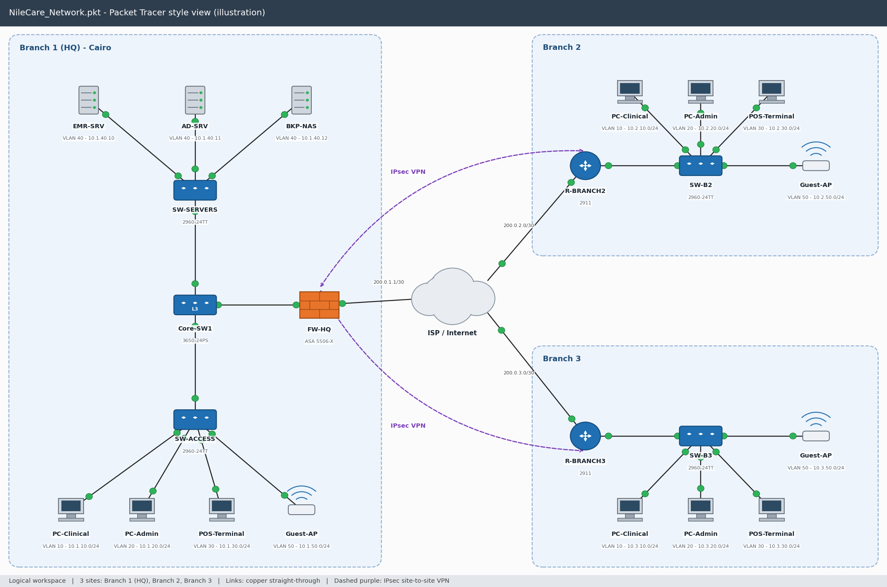

# NileCare – ISO 27001:2022 GRC Practice Project

A hands-on Governance, Risk and Compliance (GRC) project built around a **fictional company**, to practice the full cycle: asset inventory → risk assessment → gap assessment → policies.

> **Disclaimer:** NileCare, its people, systems and findings are invented for learning. This is not a real audit.

## The Company (fictional)
**NileCare** is a private clinics group in Cairo with 3 sites (HQ as Branch 1, plus 2 more branches) and about 120 staff. It runs an electronic medical records (EMR) system, a patient database, lab and imaging systems, and an online appointment portal. It handles sensitive health data and falls under the Egyptian Personal Data Protection Law (Law 151 of 2020).

## What's Inside
| File | Description |
|---|---|
| `NileCare_Risk_Assessment.xlsx` | Asset inventory (20 assets), risk register (16 risks), scoring key and summary |
| `NileCare_Gap_Assessment.xlsx` | All 93 ISO 27001:2022 Annex A controls assessed, with priorities and links to risks |
| `policies/Access_Control_Policy.md` | Access control, MFA, privileged access, access reviews |
| `policies/Incident_Response_Policy.md` | Reporting, severity levels, response phases, notification |
| `policies/Backup_and_Recovery_Policy.md` | 3-2-1 backups, recovery targets, restore testing |
| `Packet_Tracer_Configs.md` | Network design for 3 sites (VLANs, firewall, ACLs, IPsec VPN) with device configs for Cisco Packet Tracer |
| `NileCare_Network_Design_and_Configs.pdf` | Same network design and configs as a single PDF |
| `NileCare_Network_PacketTracer_style.png` | Topology diagram |

## Network Design

Segmented network (clinical, admin, POS, servers, guest and management VLANs), firewall with NAT, ACLs that isolate guest and POS traffic from internal systems, and site-to-site IPsec VPN. Configs are documented in `Packet_Tracer_Configs.md`.

## Methodology
1. **Assets:** identified and rated for Confidentiality, Integrity and Availability (1–3).
2. **Risks:** `Risk score = Likelihood (1–5) × Impact (1–5)`. Levels: Low (1–4), Medium (5–9), High (10–16), Critical (17–25). Each risk is mapped to an Annex A control and a treatment plan, with residual risk after treatment.
3. **Gap assessment:** every Annex A control is marked Implemented (1), Partially (0.5) or Not implemented (0). Compliance % = score ÷ applicable controls.
4. **Policies:** written for the highest-priority gaps and linked back to the related risks.

## Key Findings
- **Risks:** 12 of 16 risks are High or Critical before treatment (2 Critical: ransomware on the EMR and credential theft via phishing). After the planned controls, none remain High or Critical, and the average risk score falls by about 58%.
- **Compliance:** overall **30.8%** (91 applicable controls). By theme: Organizational 23.0%, People 50.0%, Physical 53.6%, Technological 25.0%.
- **Open gaps:** 85 in total – 26 High, 38 Medium, 21 Low priority.
- **Top priorities:** MFA, endpoint encryption, EDR and patching, SIEM and log monitoring, network segmentation, tested offline backups, incident response plan, supplier security clauses, and PDPL compliance.

## Skills Demonstrated
Risk assessment (likelihood × impact), asset classification, ISO/IEC 27001:2022 Annex A mapping, gap analysis, treatment planning, policy writing, privacy requirements (PDPL), and Excel modelling with formulas and conditional formatting.

## Possible Next Steps
Statement of Applicability (SoA), risk treatment plan tracker, Information Security Policy, and a short management review report.

---
*Author: Hager Abdelrahman – IT graduate specializing in cybersecurity and SOC operations, Cairo, Egypt.* [LinkedIn](https://www.linkedin.com/in/hager-abdelrahman-헤이거-5a55bb356)
